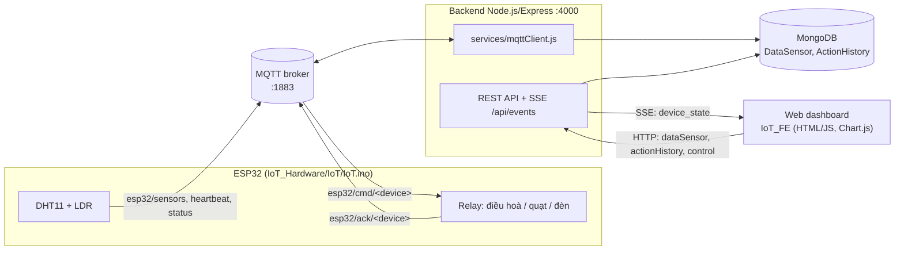

# IoT_project — Hệ thống giám sát và điều khiển thiết bị qua ESP32 + MQTT

> **EN:** ESP32 smart-room system: DHT11/LDR sensor data over MQTT to a Node.js/Express + MongoDB backend, with a web dashboard to monitor sensors and switch an air conditioner, fan and light.

## Mô tả

ESP32 đọc nhiệt độ, độ ẩm (DHT11) và ánh sáng (LDR), gửi lên MQTT broker mỗi 2 giây. Backend Node.js subscribe các topic, lưu dữ liệu vào MongoDB và cung cấp REST API cho dashboard web. Từ dashboard, người dùng bật/tắt **điều hoà, quạt, đèn**; lệnh đi qua MQTT tới ESP32, ESP32 điều khiển relay rồi gửi ACK về để backend ghi lịch sử và đẩy trạng thái mới cho trình duyệt qua Server-Sent Events.

Tính năng có trong code:
- Thu thập cảm biến: nhiệt độ, độ ẩm, ánh sáng (định dạng JSON `esp32/sensors`, vẫn hỗ trợ topic cũ `esp32/temperature|humidity|light`); chống lưu trùng (tối thiểu 1 giây hoặc dữ liệu thay đổi đáng kể).
- Điều khiển 3 thiết bị qua relay, xác nhận bằng ACK (`esp32/ack/<device>`), lưu `ActionHistory` khi trạng thái thực sự thay đổi.
- Theo dõi kết nối ESP32: LWT `esp32/status` (online/offline) + heartbeat, timeout 5 giây.
- Đồng bộ trạng thái: khi ESP32 kết nối lại (`esp32/sync_request`), backend gửi lại trạng thái cuối cùng của từng thiết bị lấy từ MongoDB.
- API lịch sử cảm biến và lịch sử điều khiển có lọc, tìm kiếm, sắp xếp, phân trang.
- Giới hạn tần suất lệnh điều khiển: 30 lệnh/phút/IP.
- Health check `/health` (MongoDB, MQTT, ESP32).
- Giao diện web 4 trang: Dashboard (biểu đồ Chart.js + nút điều khiển), Data Sensor, Action History, Profile.

## Kiến trúc



### MQTT topics

| Topic | Hướng | Nội dung |
|---|---|---|
| `esp32/sensors` | ESP32 → backend | JSON `{temp, hum, light}` mỗi 2 giây |
| `esp32/heartbeat` | ESP32 → backend | `alive` |
| `esp32/status` | ESP32 → backend | `online` / `offline` (retain, LWT) |
| `esp32/sync_request` | ESP32 → backend | yêu cầu đồng bộ trạng thái khi kết nối lại |
| `esp32/cmd/{dieuhoa,quat,den}` | backend → ESP32 | `ON` / `OFF` |
| `esp32/ack/{dieuhoa,quat,den}` | ESP32 → backend | trạng thái sau khi thực thi |

### REST API (backend)

| Method | Đường dẫn | Chức năng |
|---|---|---|
| GET | `/api/dataSensor/latest` | 10 bản ghi cảm biến mới nhất |
| GET | `/api/dataSensor` | lịch sử cảm biến: `search`, `sortField`, `sortOrder`, `page`, `limit` (≤ 50) |
| GET | `/api/actionHistory/filter` | lịch sử điều khiển: `device`, `state`, `search`, `page`, `pageSize` |
| GET | `/api/control/status` | trạng thái hiện tại của 3 thiết bị |
| POST | `/api/control` | body `{ "device": "den", "action": "ON" }` |
| GET | `/api/events` | Server-Sent Events trạng thái thiết bị |
| GET | `/health` | tình trạng MongoDB / MQTT / ESP32 |

## Công nghệ

- **Phần cứng:** ESP32, DHT11, quang trở LDR, module relay. Thư viện Arduino: `WiFi`, `PubSubClient`, `DHT sensor library`.
- **Backend:** Node.js, Express 4, Mongoose 7, mqtt.js 4, dotenv, express-rate-limit, cors.
- **Cơ sở dữ liệu:** MongoDB.
- **Frontend:** HTML/CSS/JavaScript thuần, Bootstrap 5, Font Awesome, Chart.js.
- **Broker:** bất kỳ MQTT broker nào có xác thực username/password (ví dụ Mosquitto).

## Cách chạy

### 1. MQTT broker và MongoDB
Chạy một MQTT broker (cổng 1883, có tài khoản) và MongoDB (mặc định `mongodb://localhost:27017/iotdb`).

### 2. Backend
```bash
cd IoT_software/BE_IoT
cp .env.example .env      # rồi điền MQTT_BROKER_URL, MQTT_USERNAME, MQTT_PASSWORD, MONGODB_URI
npm install
npm start                 # hoặc: npm run dev (nodemon)
```
Backend lắng nghe ở `http://0.0.0.0:4000`.

### 3. Firmware ESP32
1. Copy `IoT_Hardware/IoT/secrets.example.h` thành `IoT_Hardware/IoT/secrets.h` và điền Wi-Fi + tài khoản MQTT (`secrets.h` đã được `.gitignore`).
2. Sửa `mqtt_server` trong `IoT.ino` thành IP của broker.
3. Mở `IoT.ino` bằng Arduino IDE, cài `PubSubClient` và `DHT sensor library`, chọn board ESP32 và nạp.

Đấu nối: DHT11 → GPIO16, LDR → GPIO32, relay điều hoà → GPIO18, quạt → GPIO13, đèn → GPIO26.

> `IoT_software/ESP32_Optimized.ino` là bản giống `IoT.ino` (chỉ khác IP broker); dùng `IoT_software/secrets.example.h` tương tự.

### 4. Frontend
Phục vụ thư mục `IoT_software/IoT_FE` bằng một static server bất kỳ, ví dụ:
```bash
cd IoT_software/IoT_FE
npx serve .               # hoặc Live Server của VS Code
```
Frontend tự gọi API tại `http://<hostname>:4000` (xem `js/config.js`).

## Cấu trúc thư mục

```
IoT_project/
├── IoT_Hardware/IoT/
│   ├── IoT.ino                 # firmware ESP32: cảm biến, relay, MQTT
│   └── secrets.example.h       # mẫu Wi-Fi/MQTT credentials
└── IoT_software/
    ├── ESP32_Optimized.ino     # bản firmware tương tự (IP broker khác)
    ├── secrets.example.h
    ├── BE_IoT/                 # backend Node.js
    │   ├── server.js           # Express, SSE, /health
    │   ├── config/database.js  # kết nối MongoDB
    │   ├── services/mqttClient.js
    │   ├── models/             # DataSensor, ActionHistory
    │   ├── routes/             # dataSensor, actionHistory, control
    │   └── .env.example
    ├── IoT_FE/                 # dashboard web
    │   ├── index.html, dataSensor.html, actionHistory.html, profile.html
    │   ├── js/  css/  components/
    └── images/
```
